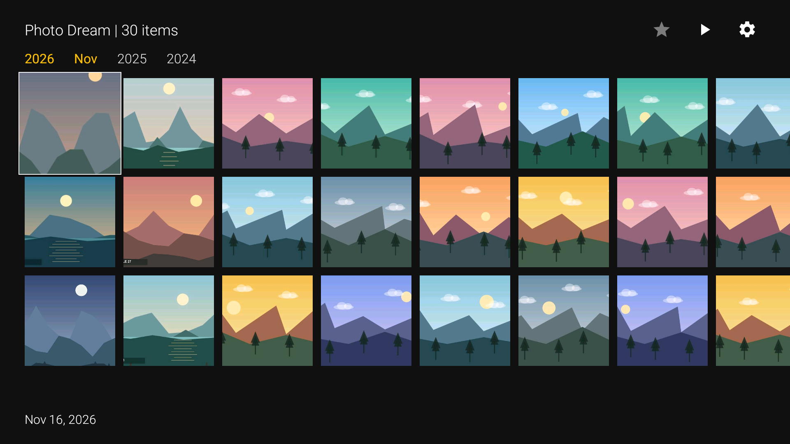
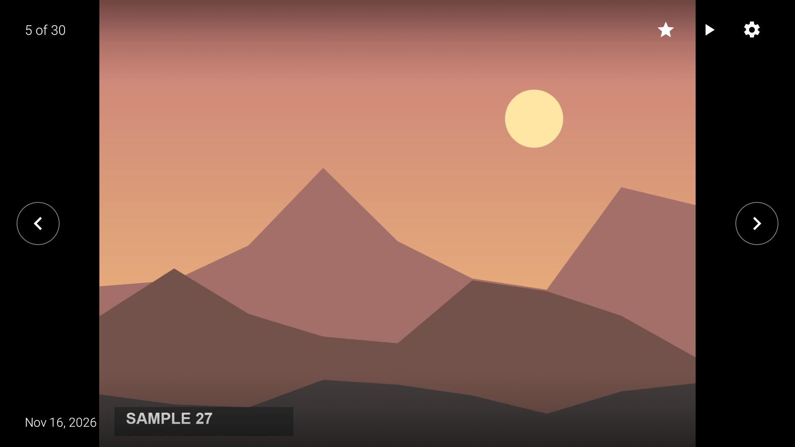
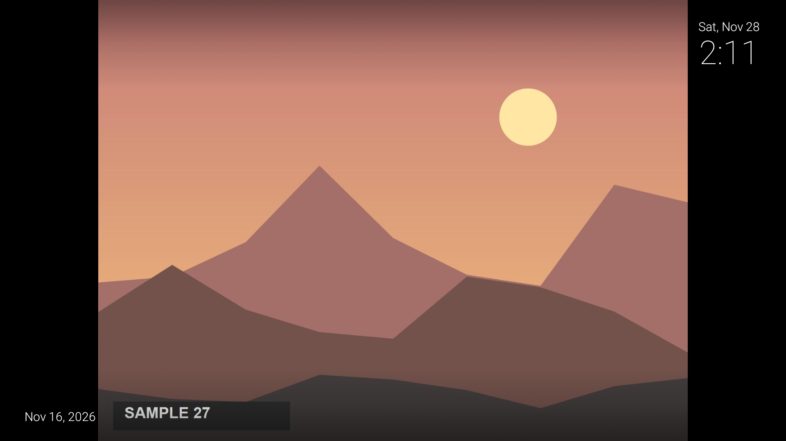
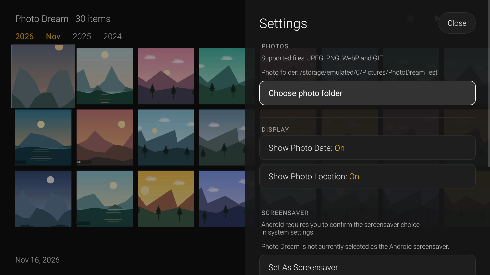
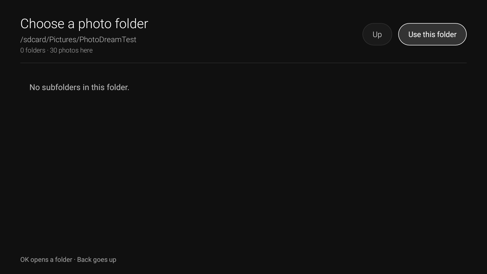

# Photo Dream

A lightweight, D-pad-first Android TV photo gallery and screensaver (`DreamService`) built for older, memory-constrained Android TVs.

Designed first for a **Sony BRAVIA KD-55X9500D** running **Android 8.0 (API 26)** with ~1.5 GB RAM, a 192 MB Java heap limit, no touchscreen, no `DocumentsUI`, and no keyboard. Zero telemetry, zero analytics, zero ads, and zero Google Play Services.



## Features

- **Gallery:** Opens directly to a centered, 3-row square thumbnail timeline sorted newest-first with the first photo focused immediately, scrolling horizontally across the full screen width with `1.14x` highlight zoom, crisp thin borders, and bottom date/location metadata. Year and month shortcuts track the highlighted photo in gold, expand one year at a time, and jump straight to the newest photo in that period.
- **Full-Screen Preview & Photo Details:** Displays photos at display resolution within the heap budget with a top-left `1 of N` counter, top-right favorite/play/settings icons, soft top/bottom edge scrims for bright photos, animated `Loading...` wave text, edge `<` / `>` direction indicators that slide away after a few seconds, and a Preview Settings panel showing EXIF photo details (file, date & time, resolution/megapixels, camera, shutter speed, aperture, ISO, focal length, location, and GPS coordinates).
- **Slideshow & Screensaver Parity:** Manual slideshow (`SlideshowActivity`) and the Android system screensaver (`PhotoDream`) share the same visual stage (`SlideshowStage`): full-screen photo with soft edge scrims, centered upper-right date & thin clock, shadowed date/location footer, Cut / Fade / Slide transitions, and a subtle pulsing `Paused` label in the top-left corner when paused. Both prefetch one frame ahead, refresh their index quietly in the background, and fall back gracefully on unreadable files.
- **Favorites & Smart Resume:** Gold is reserved strictly for state (favorite photos, enabled toggles, active year/month). The All/Favorites filter is shared across gallery, slideshow, and screensaver. With Shuffle off, the screensaver resumes after the last photo it showed.
- **Date & Offline-Cached Location:** Reads EXIF capture date (falling back to file modified time) and optional GPS location formatted as `Suburb, CC` via Android's `Geocoder`, cached locally so previously resolved names still appear offline. The app opens no network sockets of its own.
- **D-Pad Settings & Folder Explorer:** Semi-transparent right-side Settings panel with live gallery updates as soon as you pick a folder, automatic storage permission prompting on startup or folder selection, and a built-in `/storage` folder browser (internal storage + USB drives, no `DocumentsUI` needed) with direct subfolder/photo counts and smart focus restoration.
- **Fast Repeat Opens, USB Wake Recovery & Bounded Memory:** Persists an incremental photo index (`photo_index.tsv`) and a `32 MB` LRU thumbnail disk cache so repeat opens skip full EXIF/JPEG rescans, preserves the cached index and auto-recovers when external USB drives spin up after TV sleep, uses a dark icon-only cold-start launch screen, and keeps slideshow bitmaps strictly within a three-frame heap budget.

## Screenshots

| Full-Screen Preview | Slideshow & Screensaver |
|---|---|
|  |  |

| Settings Panel | D-Pad Folder Explorer |
|---|---|
|  |  |

*Screenshots captured on an Android TV API 26 emulator using the generated fixtures in `test-data/sample-photos`.*

## Current Status & Roadmap

**Done**
- Local & USB photo gallery, full-screen preview, manual slideshow, `DreamService` screensaver, D-pad Settings panel, and built-in folder explorer.
- Incremental disk index (`PhotoIndex`), bounded LRU disk cache (`DiskPhotoCache`), source-agnostic `PhotoSource` / `PhotoRef` data layer, typed preferences (`PhotoPreferences`), 1-frame slideshow prefetch, and JVM unit tests with `FakePhotoSource`.
- Tested on an Android TV API 26 emulator and sideloaded on Fire TV and Sony KD-55X9500D; long-run Sony TV memory (`dumpsys meminfo`), USB access with debugging off, and idle `DreamService` activation are still to be recorded in [docs/DEPLOY.md](docs/DEPLOY.md).

**Roadmap (in priority order)**
1. **Local network sources (next):** **Immich** (LAN HTTP/HTTPS + API key + server-sized thumbnails, zero new dependencies, avoids Android 8 HEIC decoding limits) and **SMB** shares (evaluating library APK/heap cost before adding), with Plex/WebDAV optional.
2. **Online cloud sources (later):** OneDrive, Google Drive, iCloud/others as their APIs allow, one at a time, using read-only scopes and Android Keystore-encrypted tokens.
3. **Polish:** Optional clock toggle, Ken Burns zoom (if the Sony GPU copes), and translations.

**Needed before Immich / SMB**
1. For **Immich**: server LAN URL (e.g. `http://192.168.1.50:2283`), a read-only API key (stored encrypted on the TV, never committed), and whether to browse an album or the whole library.
2. For **SMB**: share path (`\\<host>\<share>\<folder>`), guest vs. username/password auth, and whether HEIC photos are present (Android 8 cannot decode HEIC natively).

## Build & Test

Requires JDK 17 and Android SDK platform 34 with build-tools 34.0.0 (Gradle 8.9, AGP 8.5.2, Kotlin stdlib + `androidx.leanback:leanback:1.0.0` only).

```powershell
$env:JAVA_HOME = 'C:\Program Files\Microsoft\jdk-17.0.20.101-hotspot'
$env:ANDROID_HOME = "$env:LOCALAPPDATA\Android\Sdk"
.\gradlew.bat --no-daemon testDebugUnitTest assembleRelease
```

The release APK is written to `app\build\outputs\apk\release\app-release.apk`. See [docs/DEPLOY.md](docs/DEPLOY.md) for sideloading over ADB with the `cleanyourtv` tools and closing ADB afterwards.

## Project Layout

```text
app/src/main/java/com/photodream/tv/
  GalleryActivity.kt        Launcher, 3-row virtualized thumbnail gallery, year/month timeline
  PhotoPreviewActivity.kt   Full-screen preview, 1-of-N counter, < > edge indicators
  SlideshowActivity.kt      Manual immersive slideshow (shared stage with PhotoDream)
  PhotoDream.kt             Android DreamService screensaver
  SettingsActivity.kt       D-pad half-width settings panel (full and preview-only modes)
  FolderPickerActivity.kt   Built-in /storage and USB folder browser
  TvScreenUi.kt             TvDesignTokens, shared SlideshowStage, card/pill/icon controls
  PhotoSource.kt            PhotoSource interface, LocalPhotoSource, PhotoRepository, PhotoRef
  PhotoIndex.kt             Incremental disk index (photo_index.tsv)
  DiskPhotoCache.kt         Bounded LRU disk cache (thumbnails & remote photos)
  PhotoImageDecoder.kt      Heap-budgeted sampled decoding, EXIF orientation, stream decoding
  PhotoMetadata.kt          EXIF capture time & GPS reader
  PhotoLocation.kt          Offline-cached Geocoder "Suburb, CC" lookup
  PhotoPreferences.kt       Typed SharedPreferences wrapper
  PhotoFiles.kt             Recursive image scanning, timeline building, sorting
  PhotoFavorites.kt         Per-folder favorite filtering and persistence
  PhotoClock.kt             Upper-right date & thin time overlay
  SlideshowSpeed.kt         Slow (15s) / Medium (8s) / Fast (3s) presets
  NetworkMonitor.kt         API-guarded connectivity check for future LAN/cloud sources
docs/                       CONTEXT.md, DESIGN.md, DEPLOY.md, screenshots/
test-data/sample-photos/    30 generated sample photo fixtures
```

## Documentation

| Doc | Contents |
|---|---|
| [docs/CONTEXT.md](docs/CONTEXT.md) | Target TV specs, `DreamService` notes, `cleanyourtv` rules, build environment |
| [docs/DESIGN.md](docs/DESIGN.md) | Architecture, memory budget, local/LAN/cloud source designs, milestones |
| [docs/DEPLOY.md](docs/DEPLOY.md) | Build, sideload, select/undo screensaver, close ADB safely |
| [AGENTS.md](AGENTS.md) | Rules and verification checklist for coding agents |

## Licence

Photo Dream is free software under the GNU General Public License, version 3 or (at your option) any later version; see [LICENSE](LICENSE).

Copyright (C) 2026 Rocky Adam Tauhid <rockytauhid@gmail.com>

This program comes with ABSOLUTELY NO WARRANTY. Anyone who distributes it or a program based on it must do so under the same licence and provide the source code. Code copied from cleanyourtv is MIT licensed, which is compatible with the GPL; keep its copyright notice. The AndroidX and Leanback libraries are Apache-2.0, which is also compatible with GPL-3.0.
